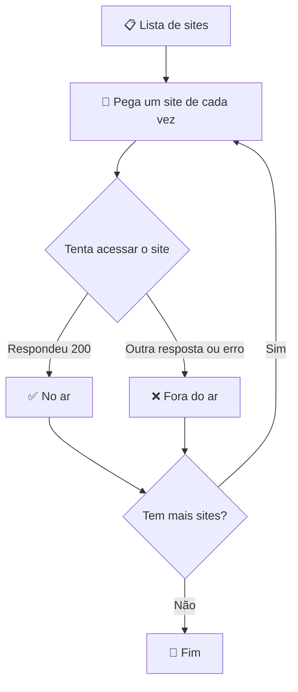

# 💻 Trilha de Programação com Python

Nesta pasta, vou guardar todos os meus códigos, testes e anotações sobre lógica de programação usando a linguagem Python.

## 🎯 O que vou aprender:
* **Variáveis:** Como criar "caixas" na memória do computador para guardar informações (como nomes, números ou links de sites).
* **Estruturas Condicionais (if/else):** Como ensinar o computador a tomar decisões (Exemplo: **SE** o site responder, mostre verde; **SENÃO**, mostre vermelho).
* **Estruturas de Repetição (Loops):** Como fazer o computador testar vários sites seguidos sem eu precisar mandar um por um.

## 🤖 Projeto: Verificador de Sites

O robô lê uma lista de sites e testa um por um, avisando se cada um está ✅ no ar ou ❌ fora do ar.

### Como o robô pensa



### Como rodar

```bash
python3 verificador_sites.py
```
