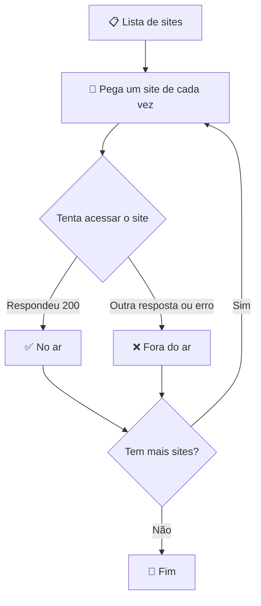
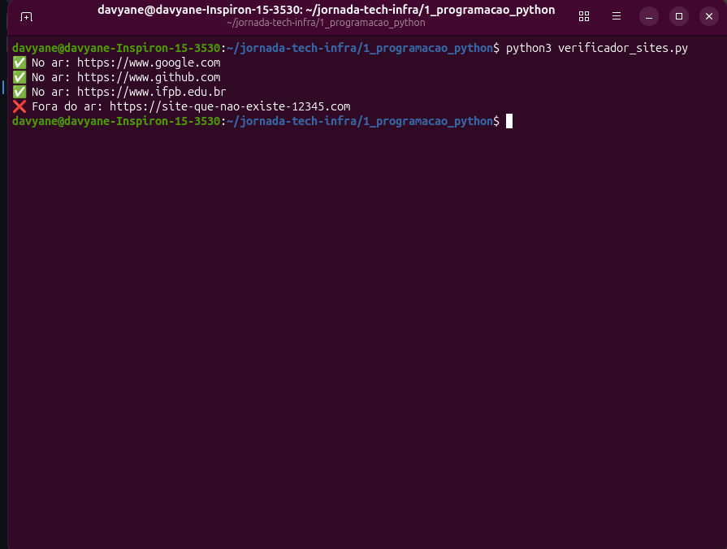
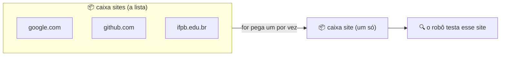

# 💻 Trilha de Programação com Python

Nesta pasta, vou guardar todos os meus códigos, testes e anotações sobre lógica de programação usando a linguagem Python.

## 🎯 O que vou aprender:
* **Variáveis:** Como criar "caixas" na memória do computador para guardar informações (como nomes, números ou links de sites).
* **Estruturas Condicionais (if/else):** Como ensinar o computador a tomar decisões (Exemplo: **SE** o site responder, mostre verde; **SENÃO**, mostre vermelho).
* **Estruturas de Repetição (Loops):** Como fazer o computador testar vários sites seguidos sem eu precisar mandar um por um.

## 🤖 Projeto: Verificador de Sites

O robô lê uma lista de sites e testa um por um, avisando se cada um está ✅ no ar ou ❌ fora do ar.

### Como o robô pensa



### Como rodar

```bash
python3 verificador_sites.py
```

### Robô funcionando

Este é o resultado real do robô no terminal: três sites ✅ no ar e um site falso ❌ fora do ar, de propósito, para mostrar que o robô não trava quando algo falha.



## 📦 Variáveis: as caixas do computador

> **Em uma frase:** uma variável é uma caixa com nome, onde o computador guarda uma informação.

### 🏠 Pense assim
Imagine caixas de mudança com etiqueta. Quando você quer algo, pede a caixa pelo nome, e o computador faz igual.

### 💻 No meu robô
```python
sites = ["https://www.google.com", "https://www.github.com"]
site = "https://www.google.com"
```

### 🎨 Em desenho


| Caixa | O que guarda |
|---|---|
| `sites` | a lista com todos os endereços |
| `site` | um endereço só (o da vez no loop) |

### 🧪 Teste você
Troque `sites` por `lista_de_sites` nas duas linhas e rode. O que acontece?

<details>
<summary>👀 Ver resposta</summary>

Nada muda! O nome da caixa serve só para a gente entender o código.
</details>

### ⚠️ Erro que eu cometi
Achei que `site` e `sites` fossem a mesma coisa. Uma é a lista inteira, a outra é um item dela.
